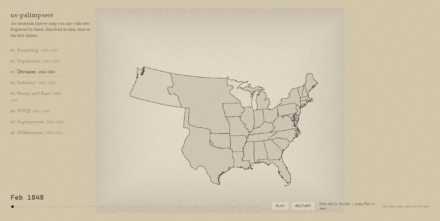
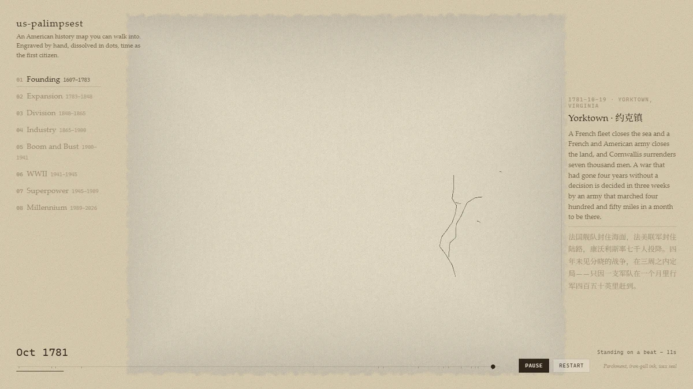
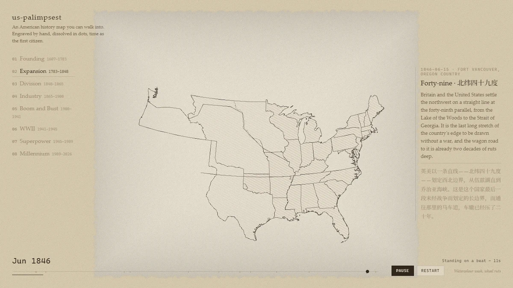
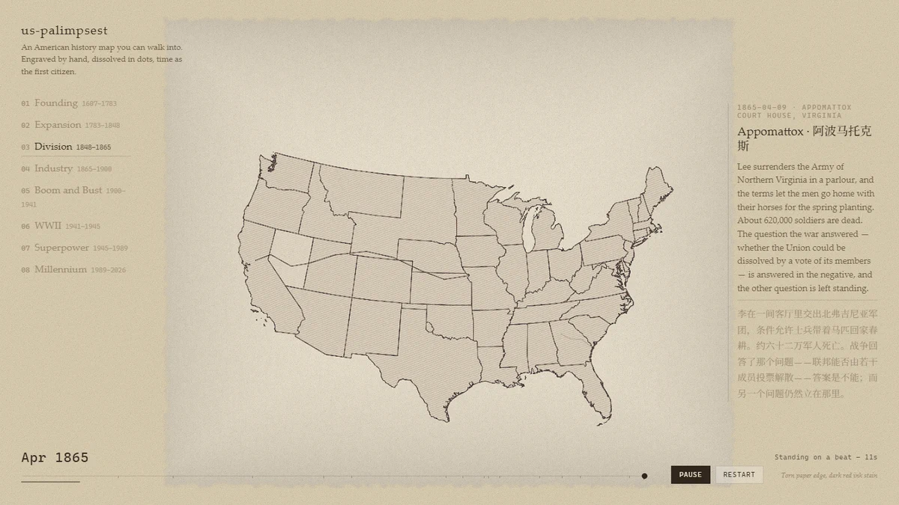
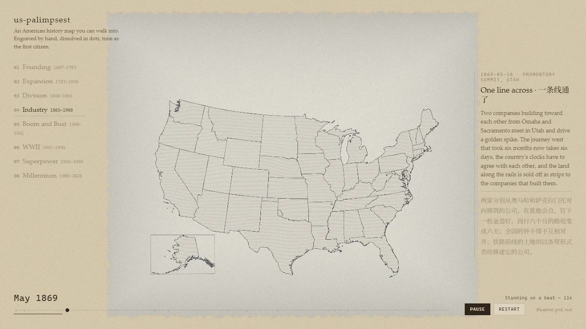
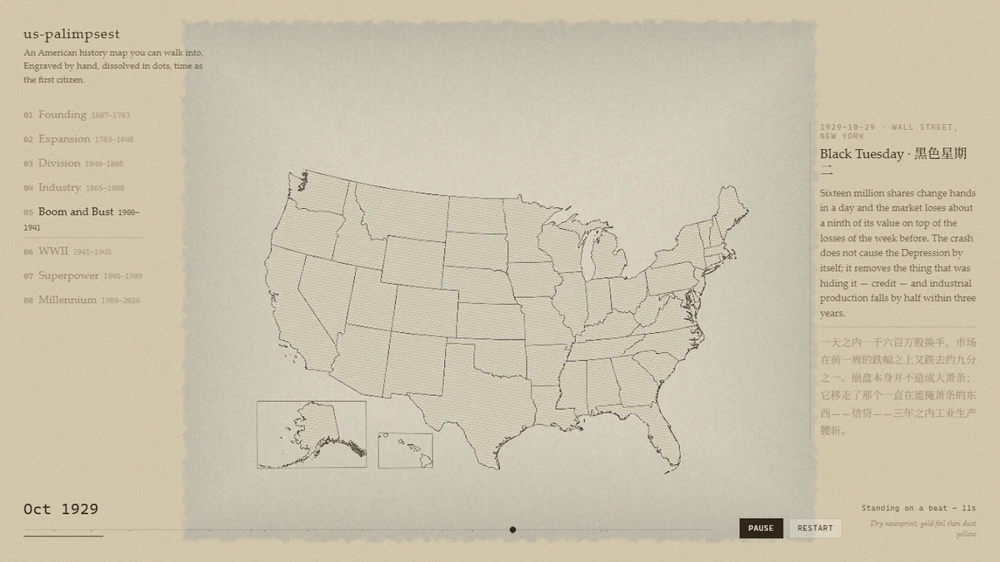
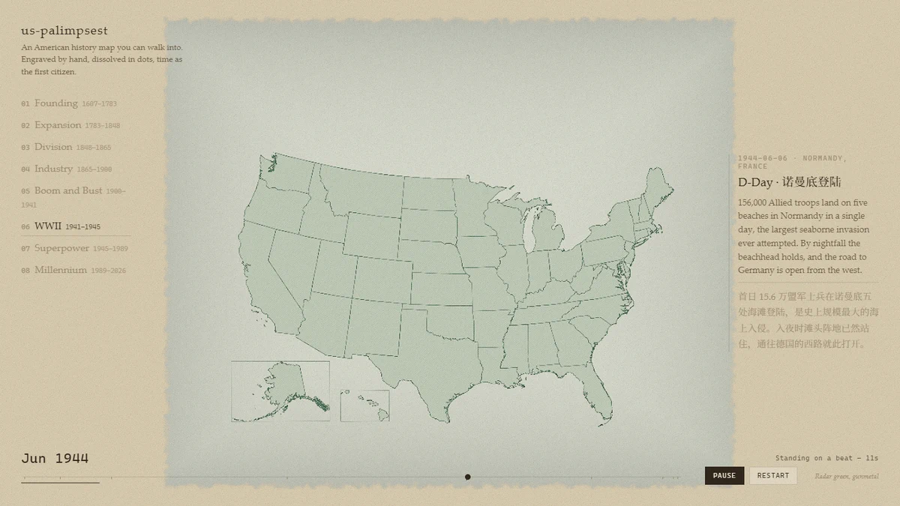
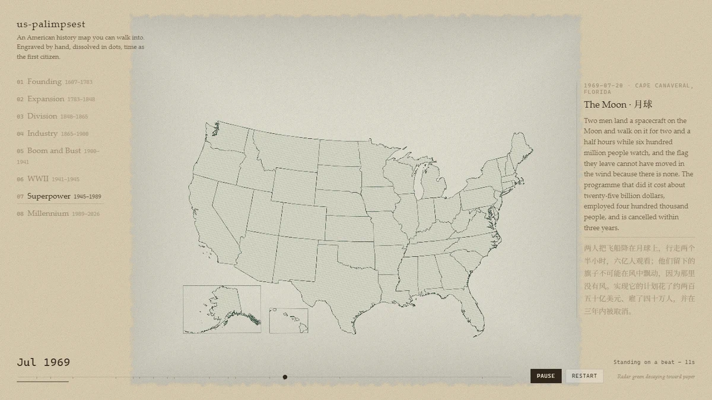
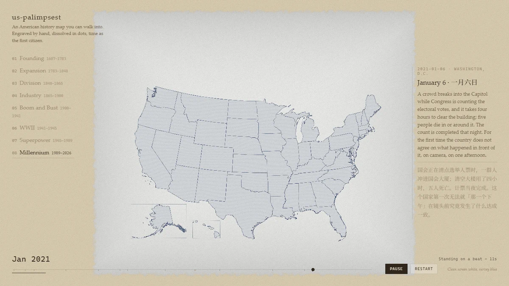
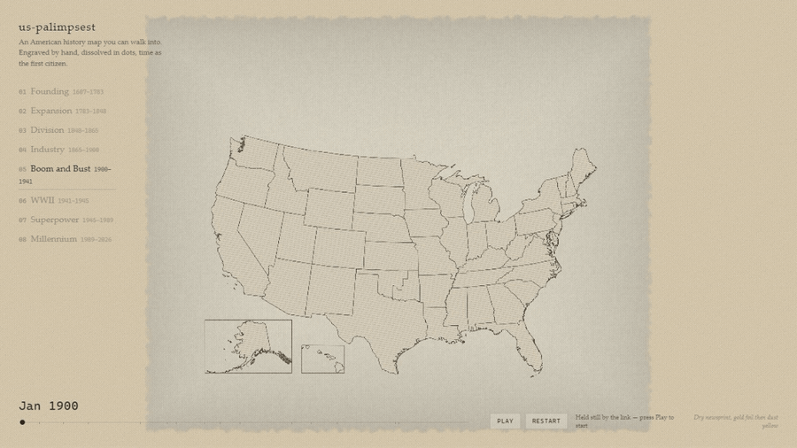

<div align="center">

<p><a href="./README.md">English</a> &nbsp;·&nbsp; <b>简体中文</b></p>

<a href="#八个章节"></a>

<h1>us-palimpsest</h1>

<p><b>一张可以走进的美国历史地图。<br>手绘雕版，粒子消散，时间作为第一公民。</b></p>

<p>
<a href="#八个章节"><b>八个章节</b></a> &nbsp;·&nbsp;
<a href="#运行">运行</a> &nbsp;·&nbsp;
<a href="docs/ARCHITECTURE.md">它怎么做的</a> &nbsp;·&nbsp;
<a href="NOTICE.md">数据来源与许可</a>
</p>

<p>
<a href="LICENSE"></a>
<a href="NOTICE.md"></a>


</p>

</div>

<br>

**us-palimpsest** 是一个基于 Three.js 的交互式美国历史三维地图集。它把四个世纪里不断变化的疆域画在同一张手绘地图上——边界按日期切出、城市逐次亮起、一章溶进下一章——而且它会自己放：打开页面，片子就开始走，从詹姆斯敦一直到一月六日，八章连播，全长二十三分四十九秒。

它同时也是**写出来的**。每章承载一串带日期的时刻——一条路、一次行军、一场投降、一篇演说——游标会停在上面，右侧的面板把它们读出来。在国土轮廓已经不再移动的地方，这些文字**就是**版面据以绘制的东西。

美术方向参考 [Chartogne-Taillet](https://chartogne-taillet.com/en)——Immersive Garden 制作，Bruno Simon 开发，2020 年 12 月 2 日获 Awwwards 每日最佳网站。

## 八个章节

八章，连续且互不重叠：每一年只属于一章，切点取在拐点上，而不是取在纪录片的选集边界上。每章都渲染成一种可信的实体物质。

<table>
<tr>
<td width="50%"><br><b>01 &nbsp;建国</b> &nbsp;<sub>1607–1783 · 2:59</sub><br><sub>羊皮纸与铁胆墨水——约克镇，以及本章据以绘制的那些路线：它的窗口里没有任何一条州界起笔。</sub></td>
<td width="50%"><br><b>02 &nbsp;扩张</b> &nbsp;<sub>1783–1848 · 2:56</sub><br><sub>水彩晕染压在车辙之上——俄勒冈条约，一个国家长到了它在大陆上的宽度。</sub></td>
</tr>
<tr>
<td><br><b>03 &nbsp;分裂</b> &nbsp;<sub>1848–1865 · 3:20</sub><br><sub>撕裂的纸边与暗红墨渍——阿波马托克斯，此前十七年里发生了六十三次边界变更。</sub></td>
<td><br><b>04 &nbsp;工业</b> &nbsp;<sub>1865–1900 · 2:56</sub><br><sub>蓝图网格与铁锈——普罗蒙特里的最后一颗道钉，以及第一个插图框：阿拉斯加出现在一块本来是水的角上。</sub></td>
</tr>
<tr>
<td><br><b>05 &nbsp;繁荣与萧条</b> &nbsp;<sub>1900–1941 · 3:08</sub><br><sub>干燥的新闻纸，金箔褪成尘暴黄——黑色星期二，繁荣到此为止。</sub></td>
<td><br><b>06 &nbsp;二战</b> &nbsp;<sub>1941–1945 · 1:59</sub><br><sub>雷达绿与炮铜灰，全片第一次硬性换色——诺曼底登陆，落在一个一条边界都不动的窗口上。</sub></td>
</tr>
<tr>
<td><br><b>07 &nbsp;超级大国</b> &nbsp;<sub>1945–1989 · 3:32</sub><br><sub>雷达绿向着纸色褪去——月球，以及一个轮廓再也不会移动的国家。</sub></td>
<td><br><b>08 &nbsp;千禧年</b> &nbsp;<sub>1989–2026 · 2:59</sub><br><sub>干净的屏幕白与测绘蓝——一月六日，记录的最远端。</sub></td>
</tr>
</table>

上面每一张截图都是片子**正在跑**时拍的，都落在某一次停留的头几秒；章节旁边那个数字是这一章放完要多长时间。

## 运行

```sh
npm install
npm run data:build    # 从 AHCB 源数据重新生成各章数据包
npm run dev           # http://127.0.0.1:5173
```

`npm run build` 会把静态站点写进 `dist/`，任何 web 服务器都能托管。`data/` 里生成出来的各章数据包不提交，所以 `data:build` 才是把它们放进去的那一步。

这里传的是几何，所以要放在没有「整站 1 GB、单文件 100 MB」这类限制的地方——用 Vercel，不要用 GitHub Pages。

## 使用

**它会自己放。** 打开页面片子就开始走，八章按顺序连播。在两个带日期的时刻之间，游标在走；走到一个时刻，它停十二秒，好让人读完面板——dock 会把这件事说出来：Play 按钮上方一个倒计时，时间轴下方一条逐渐填满的细线。一章放完，下一章由它的章节卡宣告，然后开始。

| 控件 | 作用 |
|---|---|
| 章节选择（顶部） | 直接跳到某一章，片子继续走 |
| 时间轴（底部） | 在章内拖动日期；故事面板完全跟随游标 |
| **Play** / **Pause** | 开始、暂停 |
| **Restart** | 回到第一章 |

### 链接

任何一个时刻都可以直接从 URL 打开。

| 参数 | 含义 | 例子 |
|---|---|---|
| `chapter` | 打开八章中的哪一章 | `chapter=division` |
| `date` | 把游标停在哪一天——`YYYY-MM-DD` 或 `YYYY-MM` | `date=1861-04-12` |
| `still` | 打开这一视图但**不**开始放映 | `still` |
| `intro` | 进来时先把开场标题卡放一遍 | `intro` |

`?chapter=division&date=1861-04-12` 直接开在萨姆特堡那一张上。加上 `still` 就是只看一个时刻、不放片：`?chapter=wwii&date=1944-06-06&still`。

## 版面上有什么

**边界，按日期切出。** 没有任何一帧是按年份预先渲染的。每个要素都保留自己的起止日期，所以轮廓是运行时从日期游标推导出来的，墨连续生长。

**锚点。** 前几章的一到三个边界状态会作为去饱和的线留在版面上——1783 年条约线、路易斯安那购地、1861 年脱离线——随后两章里逐渐变淡，直到只剩纸纹。早先的墨依然隐约可读，这正是这个名字的意思。

**插图框。** 阿拉斯加与夏威夷画在左下角的独立翻页里，各有自己的阿尔伯斯投影，落在每个章节里都是水面的那块角上。它们各自在第一批几何出现的那天现身——阿拉斯加 1867、夏威夷 1898——之后轮廓不再改变。哥伦比亚特区是一个标记加一个标签。

**故事面板。** 八章共一百零八个带日期的时刻，每个都有地点、标题和一段正文，中英双语。其中十二个还带**图形**——十四条手工描出的路线，因为记录画不出一条路、一次行军或一条测绘线：其中有詹姆斯河、大篷车道、通往康科德的路、刘易斯与克拉克溯密苏里河而上、伊利运河、俄勒冈小径、驿马快信、谢尔曼向海进军，以及第一条横贯大陆铁路。

**有十四个时刻不在画面上。** 版面是贴合本土四十八州装定的，所以太平洋战场、欧洲战场、柏林空运、朝鲜、斯普特尼克、海湾、莫斯科和阿伯塔巴德在图上没有位置；它们的卡片照样出现，只是没有镜头目标。九十个时刻落在版面上，另有四个落在插图框里。

## 章节

| # | 章节 | 年代 | 对应纪录片集数 | 材质族 | 转场意象 | 声音层 |
| - | ---- | ---- | -------------- | ------ | -------- | ------ |
| 1 | 建国 | 1607–1783 | 01 叛逆者、02 革命 | 羊皮纸、铁胆墨水、火漆 | 墨在纸上洇开 | 教堂钟声、锯木 |
| 2 | 扩张 | 1783–1848 | 03 西进 | 水彩晕染、车辙 | 尘土从地图上扬起 | 风声、马车轮 |
| 3 | 分裂 | 1848–1865 | 04 分裂、05 内战 | 撕裂的纸边、暗红墨渍 | 纸面裂成灰烬 | 远处的炮声 |
| 4 | 工业 | 1865–1900 | 06 腹地、07 城市 | 蓝图网格、铁锈 | 煤灰与火星飘散 | 蒸汽节奏、铁轨轰鸣 |
| 5 | 繁荣与萧条 | 1900–1941 | 08 繁荣、09 萧条 | 干燥新闻纸、金箔褪为尘暴黄 | 砂砾从纸上剥落 | 爵士、城市嗡鸣、风滚草 |
| 6 | 二战 | 1941–1945 | 10 二战 | 雷达绿、炮铜灰 | 粒子像雷达波般向外脉动 | 无线电静电、引擎 |
| 7 | 超级大国 | 1945–1989 | 11 超级大国 | 雷达绿向纸色褪去 | 粒子向内收回 | 广播声、城市嗡鸣 |
| 8 | 千禧年 | 1989–至今 | 12 千禧年 | 干净的屏幕白、测绘蓝 | 一道光的数据流 | 键盘声、城市嗡鸣 |

每章有多少东西可画，是数据的性质：

| 章节 | 边界几何 | 窗口内的边界变更 | 故事时刻 |
| ---- | -------- | ---------------- | -------- |
| 1 建国 | 只有路线 | — | 14 |
| 2 扩张 | 有 | 108 个要素起笔 | 13 |
| 3 分裂 | 有 | 63 | 15 |
| 4 工业 | 有 | 29 | 13 |
| 5 繁荣与萧条 | 有 | 10 | 14 |
| 6 二战 | 有 | 0 | 9 |
| 7 超级大国 | 有 | 0 | 16 |
| 8 千禧年 | 有 | 0 | 14 |

第一章完全没有边界几何：凡是够到它窗口的要素，都从它的最后一天才开始，所以那张版面是靠自己承载的路线画出来的。

## 美术方向

- **一章一种材质。** 雕版线条、墨水渲染、水彩洇染、蓝图网格、新闻纸、雷达荧光。章内不混用材质。
- **纸与墨的基调，三处硬性破例。** 各章靠技法区分——网线密度、线宽、晕染软硬——而不靠色相。只有分裂（暗红）、二战（雷达绿）、千禧年（屏幕白）三处换硬色。
- **粒子是唯一的转场。** 消散、换章、落回是同一个动作：把旧版面溶掉的那批粒子，正是随后沉积为新版面网线的同一批粒子。没有第二套转场语汇，也没有硬切。

<p align="center"></p>
<p align="center"><sub>第五章交接到第六章，真实速度。</sub></p>

## 技术选型

| 层 | 选择 | 说明 |
| -- | ---- | ---- |
| 渲染器 | Three.js | WebGL2 |
| 投影 | 阿尔伯斯等积圆锥（EPSG:5070） | 等积，所以每个州的视觉重量等于它的真实大小。阿拉斯加与夏威夷沿用各自的阿尔伯斯投影，做成插图框 |
| 着色器 | GLSL | 程序化纸面、雕版边缘抖动、网线、粒子消散 |
| 后期合成 | 自定义 GLSL 合成 | 色调映射、纸纹、调色与锐化放大合成一个 pass |
| 相机与动效 | GSAP | `timeline` 走编排好的序列，`quickTo` 走连续状态，`set` 走瞬切 |
| 数据格式 | 区间编码 TopoJSON | 按一个公布容差简化并量化 |
| 标注 | MSDF 文字（`troika-three-text`） | 与分辨率无关，任何缩放下都成立 |
| 声音 | Web Audio API | 每章环境声，交叉淡入；首次用户手势后开始 |
| 构建 | Vite，原生 JavaScript | ES modules，不用 TypeScript |
| 质量 | ESLint、Prettier、Vitest | 测试盯的是数据管线 |

渲染 pass、共享 uniform 契约、画质调节器与加载顺序，见 [`docs/ARCHITECTURE.md`](docs/ARCHITECTURE.md)。

## 数据来源

- **纽贝里图书馆——美国郡界历史地图集（AHCB）**，John H. Long 等。覆盖 **1629-03-04 → 2000-12-31**，精确到日，五十个州与特区俱全。下列各条的上游来源。
- **lmullen/historical-us-boundaries** ——同一批数据，1783–1912。它的 `CHANGE` 字段对每次边界变更都有一句人话说明，`cw.csv` 记着脱离与重新加入的日期。
- **TIGER/Line（美国人口普查局）** ——现代边界来源，也是第八章随包发布的那一份。
- **NHGIS / IPUMS** ——统计与交叉核对，从不提供几何：它免费，但许可是受限的。
- **ropensci/USAboundaries**、**OpenHistoricalMap** ——用于整形与交叉验证。
- **American Panorama**、**Chronicling America** ——交互范式、事件与报纸元数据的参考。

## 许可

**代码 MIT**，**边界数据 CC0 1.0**——纽贝里已把 AHCB 释入公有领域，两者不冲突。**TIGER/Line** 无版权，随包发布时附人口普查局的致谢。**NHGIS** 未经许可不得再分发，所以它从不提供几何。完整条款与所需引用见 [`NOTICE.md`](NOTICE.md)。

纪录片《America: The Story of Us》是结构参考；本仓库不含它的任何画面、音频或文字稿。

## 它怎么做的

地图由一条离线管线画出，浏览器只接收它的产物。

```
AHCB shapefile
  → 按章节日期范围过滤（章末为半开区间）
  → 投影，每个区域走自己的投影器
  → 用 Douglas-Peucker 简化（一个容差，由像素预算推出）
  → 追加插图框边框与本章撰写的路线，不参与简化
  → 量化并编码为 TopoJSON
  → 每章一个数据包，懒加载
```

| 文档 | 内容 |
|---|---|
| [`docs/ARCHITECTURE.md`](docs/ARCHITECTURE.md) | 渲染 pass、共享 uniform 契约、画质调节器、加载顺序，以及上表每一行的理由。 |
| [`NOTICE.md`](NOTICE.md) | 每个数据源的条款，以及各自要求的引用方式。 |
| [`pipeline/`](pipeline) | 离线工具：AHCB shapefile 进，每章一个 TopoJSON 包出。 |

## 项目结构

```
src/
  main.js         启动、帧循环、输入，各系统之间的胶水
  core/           渲染 pass、合成、唯一的 uniform 集合、加载器
  env/            章节状态：权重、调色、日期 -> 共享 uniform
  world/          纸面、边界、锚点、标注、相机
  fx/             粒子、城市光点、墨晕
  timeline/       八章及其叙述
  audio/          每章环境声
  ui/             加载页、章节卡、选择器、dock、深链接
pipeline/         AHCB shapefile -> 每章 TopoJSON 数据包
public/           favicon 一套；字体与贴图——以原样发布
data/             生成出来的各章数据包（不提交）
docs/media/       本文件用到的截图与两段预览
```

## 参考

- [Chartogne-Taillet](https://chartogne-taillet.com/en)——Immersive Garden，与 Bruno Simon、Mooders 合作。美术方向与转场参考。
- [sakura-fantasy](https://github.com/billpwchan/sakura-fantasy)——Bill Chan。技术架构参考。
- [Bruno Simon](https://bruno-simon.com/)——创意 Three.js。
- [American Panorama](https://dsl.richmond.edu/panorama/)——交互式历史地图集。
- *America: The Story of Us*（History Channel，2010）——章节结构参考。
